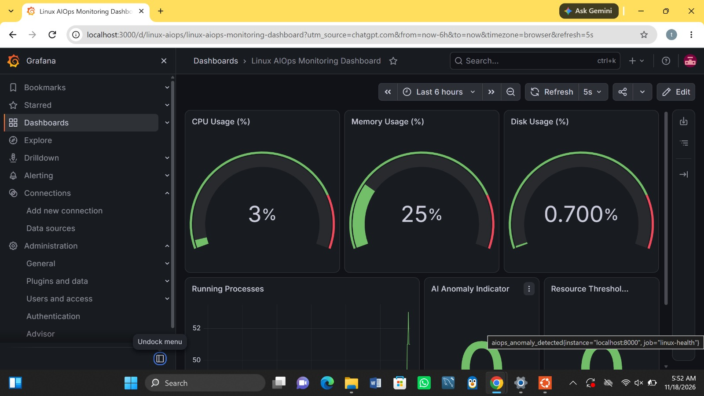

# AI-Powered Linux Infrastructure Monitoring & Auto-Remediation System

## Project Overview

This project demonstrates a Linux infrastructure monitoring and AIOps prototype that collects system health metrics, identifies unusual resource patterns using machine learning, classifies potential incidents, and uses Ansible to demonstrate controlled remediation and recovery verification.

The project combines Linux administration, Bash scripting, Python automation, Prometheus, Grafana, Ansible, and machine learning.

## Technology Stack

- **Operating System:** Linux (Ubuntu / WSL)
- **Scripting:** Bash, Python
- **Python Libraries:** Pandas, psutil, Scikit-learn, Flask
- **Automation:** Ansible
- **Monitoring:** Prometheus, Node Exporter
- **Visualization:** Grafana
- **Alerting:** Prometheus Alert Rules, Alertmanager
- **Machine Learning:** Isolation Forest
- **Data Storage:** CSV and JSON reports

## Architecture

The project consists of five main layers:

1. **Metric Collection:** Bash and Python scripts collect CPU, memory, disk, process, and system health information.
2. **API and Exporter:** Flask provides health information, while a Prometheus exporter exposes monitoring metrics.
3. **Monitoring and Visualization:** Prometheus collects metrics and Grafana displays dashboards and resource trends.
4. **AI/ML Analysis:** Pandas processes metric data and Isolation Forest identifies unusual patterns. Incident classification assigns HIGH or REVIEW priorities.
5. **Automation and Verification:** Ansible executes controlled test actions and verifies their results through file checks and a fresh health API request.

## Key Features

### Linux Health Monitoring
- CPU utilization
- Memory utilization
- Disk utilization
- Running process count
- System health reports

### Python Health API
- Flask-based health endpoint
- JSON responses
- Actual system metric collection
- Simulated warning mode for testing

Endpoint:

`http://localhost:5000/health`

Simulated warning:

`http://localhost:5000/health?simulate_warning=true`

### Prometheus and Grafana
Custom metrics include:

- `linux_cpu_usage_percent`
- `linux_memory_usage_percent`
- `linux_disk_usage_percent`
- `linux_process_count`
- `aiops_anomaly_detected`
- `aiops_resource_threshold_alert`

Grafana dashboard:

`Linux AIOps Monitoring Dashboard`

### Machine Learning Anomaly Detection

The project uses the Scikit-learn Isolation Forest algorithm to identify unusual patterns in:

- CPU usage
- Memory usage
- Disk usage
- Process count

The model generates anomaly predictions and scores in `aiops_anomaly_results.csv`.

Resource threshold alerts are evaluated separately from machine-learning anomaly predictions.

### Incident Classification

Potential anomalies are classified as:

- **HIGH:** A configured CPU, memory, or disk threshold is reached.
- **REVIEW:** The machine-learning model detects an unusual pattern, but configured resource thresholds are not exceeded.

Incident results are saved in `aiops_incident_report.csv`.

### Ansible Automation and Recovery Verification

The project includes Ansible playbooks for monitoring and controlled remediation tests.

The recovery verification workflow:

1. Requests a simulated high-CPU warning from the health API.
2. Creates a harmless temporary test file.
3. Removes the test file using Ansible.
4. Verifies that the file no longer exists.
5. Requests actual server health without warning simulation.
6. Reports the final health status.

This demonstrates automation execution and verification. It does not demonstrate actual CPU recovery.

## Project Structure

```text
project1-server-health/
│
├── ansible/
│   ├── inventory
│   ├── health_check.yml
│   ├── auto_remediation.yml
│   ├── api_monitoring.yml
│   ├── api_auto_remediation.yml
│   ├── remediation.yml
│   ├── test_remediation.yml
│   └── recovery_verification.yml
│
├── reports/
│   └── recovery_verification.log
│
├── health_check.sh
├── health_check.py
├── health_api.py
├── prometheus_exporter.py
├── alert_receiver.py
├── analyze_metrics.py
├── aiops_anomaly.py
├── aiops_incidents.py
├── aiops_decision.py
├── aiops_ansible_bridge.py
├── aiops_live_pipeline.py
├── run_aiops_pipeline.py
├── linux_metrics.csv
├── aiops_anomaly_results.csv
├── aiops_incident_report.csv
├── health_report.json
└── health_report.txt
```

## Installation and Execution

### 1. Clone the repository

```bash
git clone YOUR_GITHUB_REPOSITORY_URL
cd project1-server-health
```

### 2. Create a Python virtual environment

```bash
python3 -m venv .venv
source .venv/bin/activate
```

### 3. Install Python dependencies

Install the required packages:

```bash
pip install flask psutil pandas scikit-learn prometheus-client
```

### 4. Start the Flask health API

```bash
python health_api.py
```

### 5. Start the Prometheus exporter

In another terminal:

```bash
source .venv/bin/activate
python prometheus_exporter.py
```

### 6. Run the AI/ML pipeline

```bash
python run_aiops_pipeline.py
```

### 7. Execute Ansible recovery verification

```bash
ansible-playbook -i ansible/inventory ansible/recovery_verification.yml
```

## Test Evidence

A successful recovery verification test was completed.

| Test | Observed result |
|---|---|
| Simulated CPU warning | 95% |
| Initial API status | WARNING |
| Test remediation | Executed |
| Temporary file verification | File absent |
| Actual CPU after test | 1.5% in the saved run |
| Final API status | OK |
| Ansible failed tasks | 0 |

Execution evidence is saved in:

`reports/recovery_verification.log`

The test verifies the automation workflow, not actual CPU remediation.

## Current Limitations

- Isolation Forest inference is performed when the analysis script runs, not continuously.
- The Prometheus exporter reads the latest saved ML result.
- Ansible remediation playbooks currently demonstrate logging and harmless test actions rather than actual CPU recovery.
- Alert receiver forwarding from Alertmanager requires separate configuration and verification.
- The Flask development server is intended for local development and testing, not production deployment.

## Future Enhancements

- Multi-server monitoring using Ansible.
- AWS cloud infrastructure integration.
- Continuous machine-learning inference.
- Improved incident classification.
- Service-specific automated recovery.
- Recovery verification for real remediation actions.
- Secure alert receiver authentication.
- Production deployment using a suitable WSGI server.
- Enhanced Grafana dashboards and alert notifications.

## Project Objective

The objective is to demonstrate practical skills in Linux administration, infrastructure monitoring, Python automation, machine learning, Ansible, and AIOps workflows through a hands-on portfolio project.
## Grafana Monitoring Dashboard

The dashboard provides real-time Linux infrastructure monitoring,
including CPU, memory, disk, process count, and AI anomaly detection.


## System Architecture


